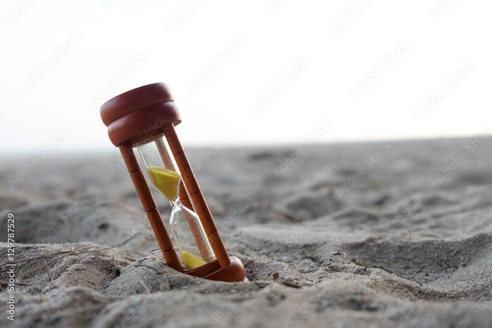

Global average life expectancy is about 73.8 years. Depending on your current age, the time you have left can be shown like this:

| Age | Years left | Months | Weeks | Days  |
|----:|-----------:|-------:|------:|------:|
| 15  | 58.8       | 706    | 3058  | 21462 |
| 25  | 48.8       | 586    | 2538  | 17802 |
| 35  | 38.8       | 466    | 2018  | 14142 |
| 45  | 28.8       | 346    | 1498  | 10482 |
| 55  | 18.8       | 226    | 978   | 6822  |
| 65  | 8.8        | 106    | 458   | 3162  |

That's fewer than 74 springs, summers, autumns, and winters. That's fewer than 74 birthdays, New Years, and so on.

### Day by day

In any day, about 1/3 of it (8 hours) goes to sleep.

Do you still want to spend so much time doomscrolling on your phone out of the remaining 18? Are you sure this is how you want to spend a large part of your life?

A Russian annual salary of roughly $20,000–25,000 works out to about $8–12.50 per hour when divided by 2,000–2,500 working hours. Using the midpoint—$22,500 divided by 2,250 hours—gives an estimate of $10 per hour.

Gen Z spends an average of about 4.5 hours per day on social media. At $8–12.50 per hour, 31.5 hours of social media per week represents roughly $252–394 of time. Even using the midpoint estimate, that is about $315 per week.

If you want to take back control of your time, you need to start now. Write down where you spend your time and think about where you really want to spend that time. What goals do you have in life?

Write down where your time goes — and decide where you want to spend it instead.

