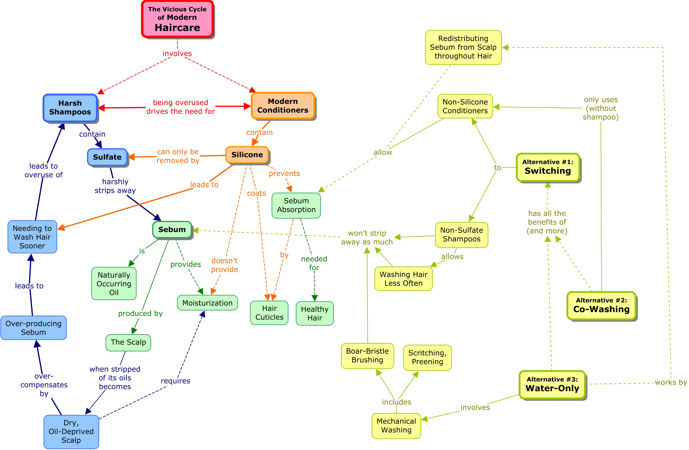

_Auto-translated from the original Russian post._

Have you ever wondered why shampoos contain so many ingredients? Or why your hair feels so dry right after washing, yet becomes greasy again too quickly? Do you feel like your hair is dry, thin, or lacking volume?

Your scalp produces a natural oil called sebum, which protects the scalp and helps moisturize hair. Most shampoos contain sulfates that remove these natural oils. Because of that, hair can feel dry, light, and less full right after washing, while a few days later it may look shinier and more voluminous again as new sebum is produced.

And what about conditioner? It coats the hair with silicones and oils that add shine, and that obviously looks good. But silicones can build up and may prevent moisture from moving freely into the hair. Adding oil back can also seem strange: people first wash oils away with shampoo and then put them back again. Before starting the transition, it helps to remove built-up silicones with a sulfate shampoo, since many of them do not rinse out well with water alone. What transition?

The transition to a more natural hair-care routine, without shampoo and conditioner. According to a [1997 study](https://pascal-francis.inist.fr/vibad/index.php?action=getRecordDetail&idt=2798275), some shampoos may increase sebum excretion. It is important to brush your hair so the natural oils spread more evenly through the length, wash with water, and massage your scalp. After the transition, you may only need to do this once a week. The [r/NoPoo community](https://reddit.com/r/NoPoo/) has discussions of different methods and experiences; its [quick-start guide](https://reddit.com/r/NoPoo/comments/hk1g37/nopoo_no_shampoo_quick_start_guide/) gives a more detailed transition plan.

Hair stays protected, can retain more moisture, may gain more volume, and can develop a more natural shine. It is no longer being repeatedly stripped of its natural oils, which may make it healthier over time.

Here are photos of my hair after about 3–4 months without shampoo, with my own haircut. The last photos are from today.

